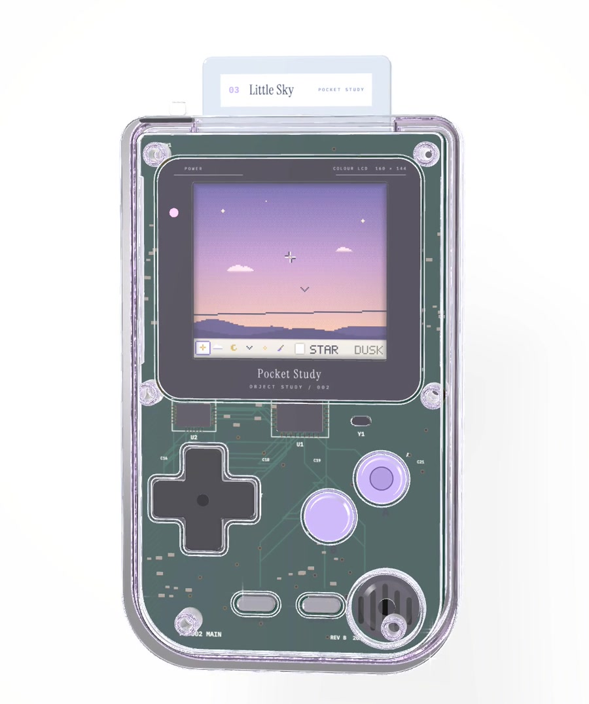

# Pocket Study

**Object Study / 002** — a clear, faintly lavender handheld console you can pick up, turn over and
play. Drag a cartridge into the slot, flick the power switch, and the game runs on the console's own
160 × 144 screen. You can see the board, the screws and the battery through the shell.

**Live:** <https://pocket-study.vercel.app>



> The glass rendering is adapted from **Ann Nguyen**'s
> [CD case](https://www.bubbbly.com/cd-case) ([source](https://github.com/annnguyentt/vibe-coding/tree/main/cd-case)),
> made with [TypingMind](https://www.typingmind.com). See [docs/ATTRIBUTION.md](docs/ATTRIBUTION.md).

**Demo films** (22 s each, recorded from the real app with real pointer and keyboard input):
[portrait 1080×1920](demo/pocket-study-portrait.mp4) · [landscape 1920×1080](demo/pocket-study-landscape.mp4) ·
[contact sheet](demo/contact-sheet.png) · [poster](demo/poster.png) · [stills](demo/screenshots) ·
[GIF](demo/insert-and-boot.gif)

## Six cartridges

| | | |
| --- | --- | --- |
| **01 Bloom** | a tiny garden | Plant, water and grow eight flowers. Growth only happens while the soil is damp. |
| **02 Starfall** | arcade | Catch falling stars, dodge rocks, dash and pulse; your best score is kept. |
| **03 Little Sky** | sky maker | Place stars, clouds, moons and birds, paint pixels, and export the sky as a PNG. |
| **04 Vine** | classic snake | Steer a growing vine to the dewdrops; it gets longer and faster. |
| **05 Glasshouse** | brick breaker | Bounce a pebble off a plank and break the coloured panes of five glasshouse roofs. |
| **06 Rally** | paddle duel | A table game against the console, on three difficulties; first to seven. |

The last three are original takes on classic genres — familiar rules, but their own names, art and
levels. Each has its own label, title screen, pause menu, save and reset, and sound. Rules are in
[docs/GAME_DESIGN.md](docs/GAME_DESIGN.md).

## Using it

- **Cartridges:** click one to pick it up, then drag it into the slot on top — a ghost outline shows where
  it goes and it snaps in when you're close. Or click it again, or use **Insert** on the card.
- **Power:** flick the switch on the top edge (or **Power on**). The console boots with its own chime.
  You can't change or eject a cartridge while it's on; switch off first and it slides back out.
- **Buttons:** press the D-pad, A, B, Start and Select on the object, or use the keyboard:

| Key | | Key | |
| --- | --- | --- | --- |
| Arrows | D-pad | Enter | Start |
| A, Z, J or Space | A | Shift | Select |
| B, X or K | B | Esc | pause |

  While a game is running, a **key guide** beside the console shows the keys for that game (for
  example "Space · launch" in Glasshouse). The **Keys** pill at the top hides or shows it, and the hint
  line under the heading says the same in one line.

- On touch screens a large on-screen pad appears while the console is on. A standard gamepad also works.
- **One cartridge at a time:** the menu next to Record demo ("All cartridges" / "Only Vine" …) leaves a
  single cartridge in the scene, so a demo can focus on one game. **Insert** then needs no selection.
  **No cartridges** clears them all away and centres the console on its own, for filming just the object.
  The choice is kept in the address, so `/?only=rally` opens with only Rally and `/?only=none` with no
  cartridges (ids: `bloom`, `starfall`, `littlesky`, `vine`, `glasshouse`, `rally`). The menu hides with
  the Record button while recording.
- **Record demo** (bottom of the page) films what you do, with the console's sound, and downloads an
  `.mp4` (or `.webm`). In Chrome, Edge and Firefox it records this tab — choose "this tab" when asked.
  Files are named `handheld-demo-<date>-<time>`. The button hides itself before the first recorded frame, so it never appears in the film; press **R** or
  your browser's **Stop sharing** to finish. Browsers without screen capture (phones) record the 3D scene
  instead, with an on-screen Stop button that isn't part of that recording.
- **Photo** saves `handheld.png` of the object. **Credits** has attribution and **Clear saved data…** (asks first).
- Drag empty space to turn the console; **Reset view** puts it back. Reduced motion is respected.

## Run it

```bash
npm install
```

```bash
npm run dev
```

Open <http://localhost:5580>. Production: `npm run build && npm start` (port 4580).

| Script | |
| --- | --- |
| `npm test` | 125 unit tests (device machine, input, runtime, all six games, text fit on every screen, key guide, PNG export, recorder) |
| `npm run test:e2e` | 10 Playwright tests in GPU Chrome with real pointer and keyboard input, including Record demo, one-cartridge mode and the key guide (`E2E_BASE_URL=…` to target a deployment) |
| `npm run typecheck` · `npm run lint` | |
| `node scripts/shoot.mjs` | visual QA stills of states and angles |
| `node scripts/film.mjs --variant=landscape` | record a demo film (also `portrait`) |
| `node scripts/media.mjs` | verify both films with ffprobe; poster, contact sheet, screenshots, GIF |

## How it's built

Next.js (pages router) + React for the page; plain Three.js for the object. The CD case's studio cube
map, ray-traced refraction rods and framebuffer sequence are generalised to a two-half shell with a
lavender body tint. A pure, time-stepped state machine owns the slot, power and drag; a fixed-step
console runtime runs the games into a 160 × 144 framebuffer that the screen shader samples directly. See
[docs/ARCHITECTURE.md](docs/ARCHITECTURE.md), [docs/TESTING.md](docs/TESTING.md),
[docs/CASE_STUDY.md](docs/CASE_STUDY.md) and [docs/SOURCE_AUDIT.md](docs/SOURCE_AUDIT.md).

## Demo films

`scripts/film.mjs` loads the app with `?capture` (manual render loop, virtual clock, memory saves, fixed
seed) and drives it with real `page.mouse` / `page.keyboard` events — the same input pipeline a person
uses. A small overlay draws the pointer and the keys being pressed, fed only by those DOM events. The
soundtrack is rendered offline from the app's logged sound events with the same synthesis code. Both films
are checked with ffprobe by `scripts/media.mjs` (results in `demo/ffprobe.json`).

## Privacy

No analytics, no accounts, no network requests besides loading the app. Saves live in this browser's
local storage and can be cleared from Credits.

## Licence

MIT for the code in this repository. The rendering technique credits Ann Nguyen's CD case, whose
repository has no licence file — see [docs/ATTRIBUTION.md](docs/ATTRIBUTION.md) for exactly what was
adapted and how it is credited.
